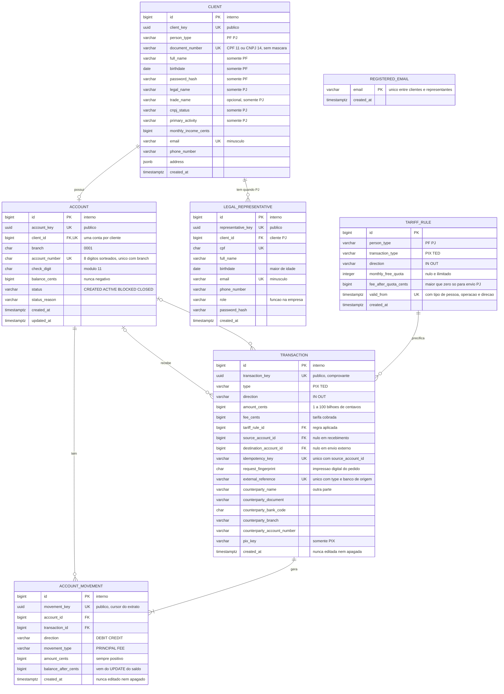

# RFC — Conta transacional PF/PJ com PIX, TED e tarifas

| | |
|---|---|
| **Time** | Maria Eduarda Oliveira · Pedro Siqueira |
| **Data** | 11/10/2026 |
| **Versão** | 9 — contrato final: fachada SDK, autorização por identidade e banco com privilégio mínimo |

## Resumo executivo

Esta RFC é a fonte principal do contrato e das decisões do projeto. A API oferece uma
fachada inspirada em SDK para reduzir a integração a quatro operações: onboarding,
autenticação, transação e extrato. Na superfície autenticada, o consumidor nunca escolhe
a conta: o backend deriva `principal -> cliente -> conta` a cada requisição.

As rotas com `client_key` e `account_key` continuam existindo exclusivamente para
compatibilidade e operação interna. Elas usam um `INTERNAL-TOKEN` compartilhado e **não
devem ser apresentadas como API de cliente**. A presença de uma UUID na URL não é, sozinha,
uma vulnerabilidade; o risco está em aceitar essa UUID como autorização. Por isso a fachada
Bearer não aceita `account_key` em path, query, body ou header.

## Contextualização

### Entendendo o problema

O sistema cadastra pessoas físicas (CPF) e jurídicas (CNPJ, com representante legal), abre
uma conta por cliente e movimenta dinheiro por PIX e TED. A garantia central é financeira:
nenhum envio é executado duas vezes, nenhum saldo fica negativo e nenhum centavo é criado
ou perdido, mesmo com concorrência, repetição do pedido ou indisponibilidade externa.

### Objetivos

- onboarding PF/PJ e abertura da conta em uma operação atômica;
- uma interface pequena para autenticar, transacionar e consultar extrato;
- autorização da conta pela identidade autenticada, não por uma chave enviada pelo cliente;
- PIX/TED idempotentes, tarifas determinísticas e extrato reconciliável com o saldo;
- privilégios mínimos no PostgreSQL e histórico financeiro append-only.


### Explicando a solução de forma macro

Um único `Client`, discriminado por `person_type`, representa PF ou PJ;
`LegalRepresentative` existe apenas para PJ, e `Account` guarda saldo e estado. Toda
movimentação é uma `Transaction` (PIX ou TED, de entrada ou saída) gravada na mesma transação
de banco que altera os saldos e cria os `AccountMovement`, as linhas imutáveis do extrato.

O modelo de tarifas também diferencia o papel de cada público no produto. A PF é a frente de
atração: não paga tarifa por PIX ou TED, o que reduz a barreira de entrada e favorece aquisição
e uso recorrente. A PJ é o principal mecanismo de receita transacional: recebe gratuitamente e
possui uma franquia mensal de 20 PIX e 2 TED de saída; depois da franquia, paga R$ 0,99 por PIX
e R$ 4,99 por TED. Assim, o pequeno negócio consegue começar com custo baixo, enquanto contas
com maior volume financiam a operação. Isso é uma hipótese de monetização do produto, não uma
demonstração contábil de lucro: a versão atual registra a tarifa cobrada, mas ainda não a
credita em uma conta de receita do banco.

| Público | Recebimentos | PIX enviados | TED enviadas | Papel no produto |
|---|---|---|---|---|
| PF | Sempre grátis | Sempre grátis | Sempre grátis | Atratividade, aquisição e recorrência. |
| PJ | Sempre grátis | 20/mês grátis; depois R$ 0,99 | 2/mês grátis; depois R$ 4,99 | Principal fonte de receita transacional. |

O envio é **síncrono**: entre clientes do banco, o dinheiro muda de conta ali mesmo; para
outro banco, o sistema consulta o Banco Central simulado, espera por tempo limitado e só
registra se houver confirmação. A tarifa vem de uma `TariffRule` versionada, e cada transação
guarda tanto a regra aplicada quanto o valor efetivamente cobrado. Recebimentos chegam por
webhook e são creditados uma única vez por referência da rede.

- **Separar clientes PF e PJ em tabelas independentes** — descartado porque duplicaria identidade, contato e relacionamento com a conta. Ganharia se os dois cadastros passassem a evoluir de forma independente.
- **Envio externo assíncrono, com estado pendente e reconciliação** — descartado porque exige conferência posterior e estorno. Ganharia se o Banco Central fosse lento ou instável a ponto de o tempo limite recusar envios válidos com frequência.
- **Persistir uma tabela de extrato** — descartado porque duplicaria os movimentos e poderia divergir do saldo. Ganharia como projeção reconstruível, se o volume de leitura exigisse.

## Implementação

### Contrato HTTP

#### Fachada inspirada em SDK — contrato recomendado

A fachada não é um pacote cliente instalado: é uma camada HTTP de alto nível inspirada na
experiência de um SDK. Ela compõe os fluxos e reaproveita as mesmas regras dos controllers
legados, sem manter uma segunda implementação financeira.

| Método | Caminho | Autenticação | Responsabilidade |
|---|---|---|---|
| `POST` | `/onboarding` | `INTERNAL-TOKEN` | Cadastra PF/PJ e abre a conta `ACTIVE` com saldo zero em um único commit. Retorna `{client, account}`. |
| `POST` | `/auth/token` | e-mail e senha | Autentica PF ou representante de PJ e emite Bearer expirável. Erro sempre genérico (`401`). |
| `POST` | `/transactions` | Bearer + `Idempotency-Key` | Envia PIX/TED pela conta derivada da identidade. Não aceita `account_key`. |
| `GET` | `/statement` | Bearer | Retorna o extrato da conta derivada da identidade, com `limit` e `after`. Não aceita `account_key`. |

O onboarding usa `INTERNAL-TOKEN` porque é uma operação servidor-servidor do integrador,
anterior à existência do titular autenticado. O login é a única troca de credenciais sem token
prévio. Transação e extrato aceitam somente Bearer; o token interno não os substitui.

#### Rotas internas e legadas

Estas rotas permanecem para compatibilidade e operação administrativa. Todas exigem
`INTERNAL-TOKEN`. As que recebem `account_key` não fazem autorização por titular e, portanto,
não devem ser expostas diretamente a aplicativos ou usuários finais.

| Método | Caminho | Uso |
|---|---|---|
| `POST` | `/clients` | Cadastro granular de PF/PJ. |
| `GET` | `/clients/{client_key}` | Consulta interna do cliente. |
| `POST` | `/clients/{client_key}/accounts` | Abertura granular de conta. |
| `GET` | `/accounts/{account_key}` | Consulta operacional de conta e saldo. |
| `PATCH` | `/accounts/{account_key}` | Bloqueio, reativação ou encerramento operacional. |
| `POST` | `/accounts/{account_key}/transactions` | Envio legado por conta escolhida pelo integrador. |
| `GET` | `/accounts/{account_key}/statement` | Extrato legado por conta escolhida pelo integrador. |
| `POST` | `/webhook/central_bank/teds` | Recebimento de TED do Banco Central simulado. |
| `POST` | `/webhook/central_bank/pix` | Recebimento de PIX do Banco Central simulado. |

`GET /` e `GET /health_check` são públicos. Toda entrada usa schema com allowlist e todo erro
mantém o envelope `title`, `description`, `translation` e `code` sem expor stack trace.

#### Decisão sobre `account_key`

- É um identificador público UUID, não uma credencial.
- Pode aparecer em respostas, comprovantes e rotas internas.
- Não pode definir o escopo das rotas de cliente autenticado.
- Na fachada, a identidade do Bearer é revalidada no banco e a única conta do cliente é
  carregada pelo relacionamento atual.
- Enquanto as rotas legadas existirem, o vazamento do `INTERNAL-TOKEN` permite escolher
  qualquer conta. Esse risco é aceito apenas para compatibilidade e deve desaparecer quando
  os consumidores internos migrarem para autorização por identidade ou por escopo de serviço.

#### Semântica HTTP da fachada

| Rota | Sucesso | Erros relevantes |
|---|---|---|
| `POST /onboarding` | `201`; cliente e conta completos | `400` schema; `409` identidade/e-mail/conta duplicados; `422` documento, idade ou CNPJ inelegível. |
| `POST /auth/token` | `200`; `access_token`, `token_type`, `expires_in` | `400` schema; `401` genérico para identidade inexistente, senha errada ou credencial inválida. |
| `POST /transactions` | `201` na criação; `200` na repetição idempotente | `400` schema/chave; `401` Bearer; `404` vínculo/destino; `422` saldo, estado, autorreferência, recusa ou chave reutilizada; `503` timeout externo. |
| `GET /statement` | `200`; `movements` e `next_cursor` | `400` query; `401` Bearer; `404` vínculo; `422` cursor inexistente ou de outra conta. |

`Idempotency-Key` é obrigatória no envio. A unicidade vale por conta de origem, e uma
impressão digital do payload impede reutilizar a mesma chave com outro pedido. O
`account_key` pode aparecer na **resposta** da transação como informação, mas nunca participa
da decisão de autorização da fachada.

Todo erro previsto usa:

```json
{"title":"...","description":"...","translation":"...","code":"QIT..."}
```

### Modelo de dados



### Fluxos

**Onboarding PF/PJ — composição atômica**

1. O integrador envia o mesmo cadastro validado da rota granular.
2. Cliente, representante (quando PJ), registro global de e-mail e conta são preparados na
   mesma sessão; a conta nasce `CREATED` e é ativada antes do único commit.
3. A resposta combina os DTOs de cliente e conta, sem senha, hash ou IDs internos.
4. Qualquer falha na abertura desfaz também o cadastro: não existe cliente órfão.

**Autenticação e resolução da conta**

1. PF autentica com o e-mail e hash guardados em `Client`; PJ autentica pelo representante
   legal. Empresa PJ não possui senha própria.
2. O Bearer assinado com HMAC-SHA256 carrega somente tipo do principal, identificador público,
   emissão e expiração; não carrega `account_key`.
3. Em cada `/transactions` ou `/statement`, o backend revalida o principal no banco, encontra
   o cliente e então sua única conta. Token inválido, expirado ou adulterado recebe `401`.
4. E-mail inexistente e senha errada produzem a mesma resposta e executam uma verificação
   Argon2id para reduzir enumeração por diferença de tempo.

**Cadastro de cliente — caminho feliz**

1. O schema escolhe as regras pelo `person_type`. PF: CPF válido, maior de idade, senha com Argon2id. PJ: CNPJ válido, situação cadastral ativa (consulta simulada) e representante adulto.
2. Cliente e representante são gravados na mesma transação de banco; o e-mail entra em `registered_email`. A resposta traz só `client_key`.

**Cadastro de cliente — falha: documento ou e-mail repetido**

1. Dois cadastros simultâneos com o mesmo e-mail disputam a chave primária de `registered_email`: o segundo espera o primeiro e recebe `409`.
2. A transação é desfeita por inteiro; nenhum cadastro parcial permanece. Nenhuma mensagem expõe CPF ou CNPJ.

**Envio PIX/TED — caminho feliz**

1. Se a `Idempotency-Key` já foi usada nesta conta, devolve a transação existente (`200`) quando o pedido é o mesmo.
2. Localiza o destino: chave PIX de cliente nosso ou TED com o código do banco (`999`) é envio interno; o resto vai para outro banco.
3. Trava as contas envolvidas com `SELECT … FOR UPDATE`, sempre na ordem do `id` (menor primeiro), e confere que estão `ACTIVE`.
4. Com a conta travada, conta os envios do mesmo tipo no mês de Brasília e aplica a `TariffRule` vigente: PJ tem 20 PIX e 2 TED grátis por mês e depois paga 99 e 499 centavos; PF e recebimentos não pagam.
5. Envio interno: grava a transação com `ON CONFLICT (source_account_id, idempotency_key) DO NOTHING`, que reserva a chave; chama `debit_account` para debitar valor e tarifa num único `UPDATE … RETURNING`; chama `credit_account` no destino e cria os movimentos (principal e tarifa na origem, principal no destino) com os saldos retornados.
6. Envio externo: debita da mesma forma, pergunta ao Banco Central e espera até 5 segundos; com a confirmação, grava a transação com os dados do recebedor e os movimentos da origem.
7. Tudo é confirmado num único commit. O recebedor recebe o valor cheio; a tarifa é uma linha separada no extrato de quem enviou.

**Envio PIX/TED — falha: saldo, concorrência ou Banco Central**

1. Se `debit_account` não altera nenhuma linha, o saldo não cobre valor e tarifa ou a conta não está ativa: rollback, `422`, e a chave de idempotência e a cota continuam livres. Sem saldo, o Banco Central nem é chamado.
2. Pedidos simultâneos na mesma conta esperam a trava; o segundo relê saldo e cota. Dois envios cruzados (A→B e B→A) pedem as travas na mesma ordem e não travam um ao outro.
3. Dois cliques com a mesma chave: o segundo espera a trava e confere a chave de novo antes de debitar (e o `ON CONFLICT` garante no banco), então recebe a mesma transação, sem novo débito nem nova chamada ao Banco Central. A mesma chave com outro pedido recebe `422`.
4. Banco Central recusa (`422`) ou não responde a tempo (`503`): rollback do débito, nada é gravado e o cliente pode tentar de novo. Risco aceito: se ele confirmar e a resposta se perder, o envio é recusado aqui, e a correção exigiria reconciliação, que está fora do escopo.

> ## Principal desafio
>
> - **Qual é:** nenhum débito duplicado, saldo negativo ou vaga grátis usada duas vezes, com pedidos simultâneos, retentativas e um banco externo que pode não responder.
> - **Por que é difícil:** ler o saldo, calcular e gravar perde atualizações sob concorrência; travas em ordens diferentes geram deadlock; e o pedido repetido pode chegar enquanto o primeiro ainda está em andamento.
> - **Como o desenho resolve:** débito atômico condicional em `debit_account`; travas sempre na ordem do `id`; chave de idempotência única por conta, conferida novamente depois da trava e garantida pelo `ON CONFLICT`; cota contada com a conta travada; e transação, movimentos e saldos num único commit. Testes black box provam transferências cruzadas, duplo clique, disputa pela última vaga grátis e conservação do dinheiro.

**Recebimento PIX/TED — caminho feliz**

1. O Banco Central avisa pelo webhook. A conta é encontrada pela chave PIX (CPF da PF, CNPJ da PJ ou e-mail) ou por agência, número e dígito.
2. A transação é gravada com `ON CONFLICT` na referência da rede; `credit_account` atualiza o saldo atomicamente e o movimento nasce com o saldo devolvido, no mesmo commit.

**Recebimento PIX/TED — falha: aviso repetido ou conta inválida**

1. O mesmo aviso repetido devolve a transação existente (`200`) sem creditar de novo; a mesma referência com outro conteúdo recebe `422`.
2. Conta ou chave inexistente recebe `404`; conta bloqueada ou encerrada recebe `422`. Nada é gravado, e o aviso pode ser reenviado depois.

**Extrato — caminho feliz**

1. Lê os `AccountMovement` da conta do mais recente para o mais antigo, em páginas de até `limit` linhas, a partir do `movement_key` informado em `after`.
2. Cada linha traz data em Brasília, descrição, valor com sinal, saldo depois e a transação; a tarifa aparece separada do valor. A soma das linhas é o saldo atual.

**Extrato — falha: cursor inválido**

1. Cursor de outra conta ou que não existe recebe `422`; cursor vazio ou longo demais, `400`; conta inexistente, `404`.
2. Um movimento novo entra no topo e não desloca as páginas seguintes, porque a próxima página começa abaixo do `id` da última linha vista.

## Segurança e proteção do banco

### Fronteiras de credencial

| Credencial | Onde existe | Poder esperado |
|---|---|---|
| `INTERNAL-TOKEN` | Integrações internas | Acessa onboarding, legado, administração e webhooks; não substitui Bearer. |
| Bearer do cliente | Titular PF ou representante PJ | Acessa somente `/transactions` e `/statement`; a conta vem do vínculo no banco. |
| `application_user` | Container da API | DML mínimo e execução das funções de saldo; sem DDL, `DELETE`, `TRUNCATE` ou `UPDATE` direto do saldo. |
| `database_owner` | Bootstrap/manutenção | Cria e migra objetos; não é entregue ao container da API. |

### Fronteira contra SQL injection

A proteção não depende de procurar palavras como `DROP` no texto recebido. Ela nasce da
separação entre **estrutura SQL** e **dados** em todas as camadas:

1. Os JSON Schemas limitam formato, tipo, tamanho, enumerações e campos aceitos
   (`additionalProperties: false`). Isso reduz a superfície de entrada, mas não é a barreira
   principal contra injection.
2. Os repositories montam consultas com expressões do SQLAlchemy (`filter`, `insert`,
   `on_conflict_do_nothing`). Valores externos são enviados ao driver como parâmetros, não
   concatenados ao comando SQL.
3. Os únicos `text()` da aplicação são comandos estáticos para `debit_account` e
   `credit_account`; `account_id` e `amount_cents` entram por bind parameters nomeados
   (`:account_id`, `:amount_cents`). Não há f-string, `%`, `.format()` ou concatenação de
   entrada externa em SQL, nem escolha dinâmica de tabela ou coluna pelo usuário.
4. Chaves UUID são convertidas antes da consulta; formato inválido vira “não encontrado”, sem
   ser incorporado ao SQL.
5. Como segunda barreira, `application_user` não pode executar DDL, `DELETE`, `TRUNCATE` nem
   atualizar saldo diretamente. Portanto, uma falha futura de validação não entrega ao processo
   da API os privilégios do owner.
6. Testes enviam payloads com aparência de SQL em e-mail, chave PIX, `Idempotency-Key`, cursor
   e identificadores públicos e confirmam que são recusados ou tratados como dados, sem alterar
   saldo, histórico ou schema.

Parametrização é a defesa central; schema estrito e privilégio mínimo são camadas adicionais.
Essa combinação é mais confiável do que tentar sanitizar manualmente strings recebidas.

O PostgreSQL revoga `CREATE`/`TEMPORARY` de `PUBLIC`, concede privilégios por operação e
coluna e mantém `transaction`, `account_movement` e `tariff_rule` append-only. Crédito e
débito passam por funções `SECURITY DEFINER`, com objetos qualificados, `search_path` fixo,
valor positivo, conta ativa e saldo suficiente. As chamadas do repository usam bind
parameters; entrada externa não é interpolada em SQL.

No Compose local, a porta do banco é publicada apenas em `127.0.0.1`. Em produção, a porta
não deve ser publicada. Isso reduz exposição de rede, mas não substitui firewall, cofre de
segredos ou identidade de workload.

## Validação

A suíte combina testes unitários de cálculos/tokens, integração HTTP black box, concorrência
financeira e testes reais de privilégios em PostgreSQL descartável. O caminho essencial da
fachada pode ser validado pelos cinco casos documentados no README: onboarding, autenticação
válida/inválida, transação autenticada e extrato autenticado.

As garantias mais importantes verificadas são:

- onboarding sem estado parcial;
- Bearer adulterado/expirado recusado e conta alheia inacessível pela fachada;
- idempotência sob repetição e concorrência;
- saldo não negativo e conservação do dinheiro;
- tarifa correta na fronteira das cotas;
- histórico imutável e privilégios destrutivos negados ao runtime;
- payloads com aparência de SQL tratados como dados ou recusados pelo schema.

## Limitações e riscos aceitos

Esta versão é um protótipo bancário consistente, não uma plataforma pronta para produção.
As limitações abaixo são deliberadas e fazem parte do contrato desta RFC.

### Autenticação e autorização

- As rotas internas/legadas aceitam um `INTERNAL-TOKEN` compartilhado. Quem obtiver esse
  segredo consegue selecionar qualquer `client_key` ou `account_key` nessas rotas. Elas devem
  permanecer atrás de uma fronteira servidor-servidor e ser descontinuadas para clientes.
- O Bearer é stateless e possui expiração, mas não há refresh token, logout, lista de
  revogação, rotação de chave ou encerramento remoto de sessão.
- Não há MFA, recuperação de senha, confirmação de e-mail/telefone, limite de tentativas ou
  rate limiting. A comparação de login reduz enumeração temporal, mas não impede força bruta.
- Existe somente uma conta por cliente. A resolução automática precisará mudar se o produto
  passar a suportar múltiplas contas, perfis ou procuradores com escopos diferentes.

### Movimentação financeira

- Envios externos são síncronos. Se o Banco Central confirmar e a resposta se perder, a API
  faz rollback local e não possui reconciliação posterior para resolver a divergência.
- Não existem estados pendentes, estorno, devolução PIX, chargeback, agendamento, limites por
  período, aprovação em duas etapas ou antifraude.
- A tarifa é debitada e registrada, mas não é creditada em uma conta contábil de receita do
  banco. Não existe razão contábil de partidas dobradas.
- O Banco Central é um Mockserver; não há integração real com SPI/STR, assinatura de mensagem,
  certificado, mTLS ou janela contra replay. Webhooks usam apenas o token interno.

### Banco de dados e operação

- `database_owner` e superusuários continuam capazes de alterar ou apagar qualquer dado; a
  proteção de privilégio mínimo se aplica ao `application_user` da API.
- Se a credencial runtime for comprometida, o invasor ainda poderá chamar as funções de
  crédito/débito e inserir os registros que a API precisa inserir. As funções limitam formato,
  estado e saldo, mas não conhecem o titular autenticado nem substituem autorização da API.
- Não há Row-Level Security, cofre de segredos, rotação automática, criptografia de campo ou
  trilha de auditoria independente. Logs possuem `x-request-id`, mas não formam um ledger de
  auditoria imutável.
- As senhas e tokens padrão do Compose são apenas para desenvolvimento local. Produção deve
  fornecer segredos próprios e não expor PostgreSQL, Uvicorn com `--reload` ou Mockserver.

### Produto, dados e conformidade

- A situação cadastral de CNPJ é simulada. Não há KYC/KYB real, prova de vida, validação de
  beneficiário final, sanções, PLD/FT ou tratamento regulatório completo.
- CPF usado como chave PIX e dados de pagador em recebimentos ainda podem aparecer em payloads
  operacionais. A política definitiva de minimização, retenção e LGPD não está implementada.
- Não há cartões, boletos, depósitos, saques, crédito, investimentos ou atendimento a disputas.
- OpenAPI/Swagger está desabilitado; o contrato é mantido pelo RFC, schemas JSON, README e
  testes. Uma API pública exigiria versionamento formal e documentação gerada.

## Próximos passos recomendados

1. Migrar consumidores internos para credenciais com escopo e retirar as rotas financeiras
   legadas que recebem `account_key`.
2. Adicionar MFA e autorização transacional vinculada a valor/destino, rate limiting e
   revogação de sessão.
3. Tornar envios externos assíncronos, com estados, reconciliação, retry seguro e estorno
   aditivo.
4. Implantar integração real assinada, KYC/KYB/PLD, gestão de segredos e auditoria imutável.
5. Evoluir para ledger contábil de partidas dobradas e conta de receita de tarifas.
